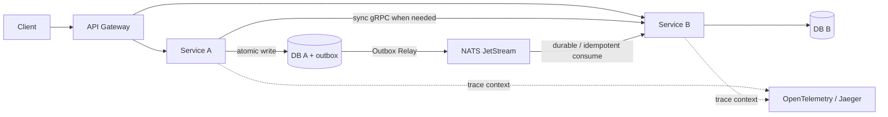

# Microservices architecture

Target building blocks for this project: how services should be bounded, how they talk, how they stay consistent under failure, and how they run in a cluster.

## Domain & data boundaries

### Bounded Contexts

Architect distinct domain boundaries so each service owns a coherent slice of the business. Splitting Identity/Auth from User Profiles, for example, isolates the security blast radius of credential handling and lets each side scale and evolve independently. Cross-context collaboration happens through published events or explicit APIs, not shared tables.

### Database-per-Service

Strict data isolation: each microservice owns and manages its own database schema. Services never query another service’s database directly.

## Communication

### Event-Driven Asynchronous Communication

Services publish domain events to a message broker rather than relying on direct REST calls, preventing a web of tightly coupled dependencies. Producers announce what happened; consumers react on their own schedule.

### Synchronous Inter-Service Communication (gRPC)

Utilizing HTTP/2 and Protocol Buffers for strict, high-speed internal queries when one service absolutely must wait for an immediate answer (like validating a token). Reserve this for query-style needs where eventual consistency is not enough; keep the default path async events.

### API Gateway

A smart Layer 7 proxy as the single public entry point, handling global concerns like stateless JWT validation, rate limiting, and routing external traffic to internal services.

## Reliability: dual writes, delivery, and retries

### The Transactional Outbox Pattern

Solves the Dual Write Problem by saving the core business data (the order) and the event payload (the message) in a single, atomic relational database transaction. Either both commit or neither does — the broker is not updated inside that transaction.

### The Outbox Relay

A dedicated background worker (using database polling or Change Data Capture) that asynchronously pushes outbox records to the message broker, isolating fast web endpoints from network delays.

### Idempotency

Design consumer services to safely handle the exact same event multiple times without side effects (like deducting inventory twice) by using unique Event IDs and database upsert locks. At-least-once delivery is the usual broker guarantee.

### Persistent Messaging (NATS JetStream)

Configure durable consumers on the broker so that if a microservice crashes, the broker holds the unacknowledged messages safely on disk until the service recovers.

## Observability

### Distributed Tracing (OpenTelemetry & Jaeger)

Inject Correlation IDs (Trace IDs) into HTTP requests and NATS message headers to visualize and debug a single user action as it jumps across multiple isolated containers.

## Runtime & local toolchain

### Kubernetes (K8s)

The foundational orchestration layer handling internal DNS service discovery, container lifecycle management, self-healing, and load balancing.

### k3d & Skaffold

The local development toolchain that allows hot-reloading code seamlessly inside a cluster that mirrors the production Kubernetes environment. Details: [k3d and Skaffold](./k3d-and-skaffold.md). For how manifests are shaped today, see [Kubernetes](./kubernetes.md).

## How the pieces fit

A typical write path: the gateway admits the request (JWT, rate limits, routing); the owning service commits business state and an outbox row together; the relay publishes to JetStream; consumers apply changes idempotently under their own database. Sync gRPC is the exception for immediate answers. Tracing headers stitch the hop together across the cluster that Kubernetes (and locally k3d + Skaffold) keeps running.
