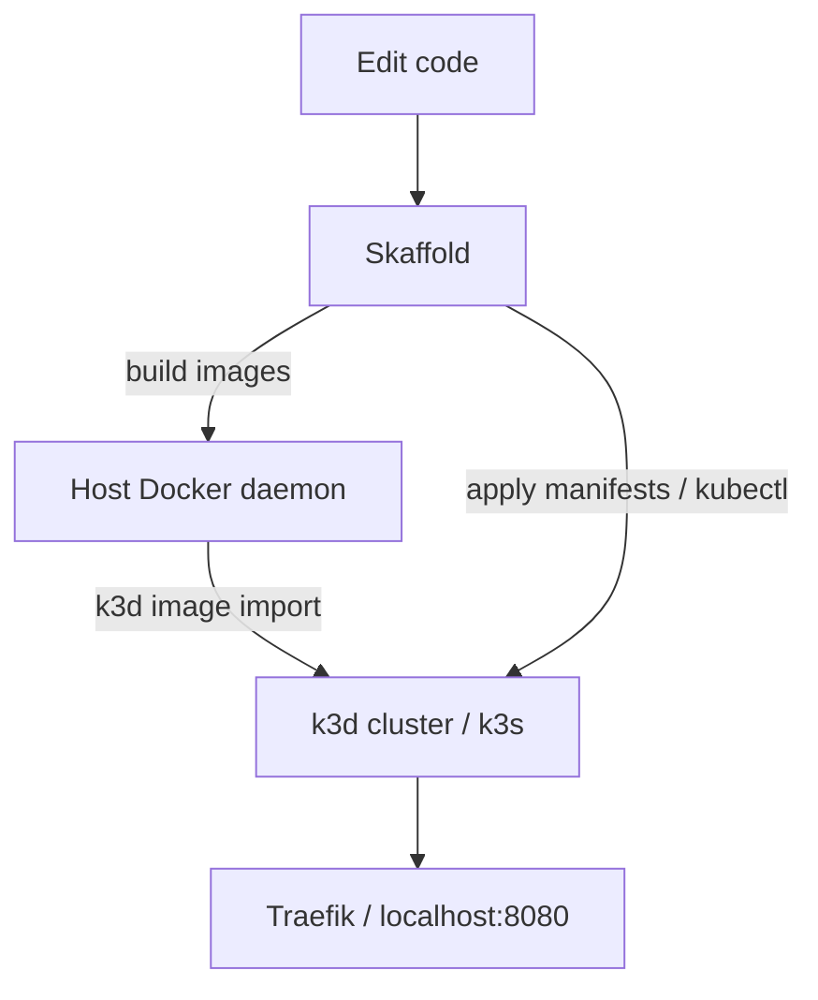

# k3d and Skaffold

Why local Kubernetes here is [k3d](https://k3d.io/), and why [Skaffold](https://skaffold.dev/) drives the build/deploy loop on top of it.

## What k3d is

**k3d** runs [k3s](https://k3s.io/) (a lightweight Kubernetes distribution) inside Docker containers. You get a real Kubernetes API, kubeconfig context, Ingress, and cluster DNS on a laptop without a separate VM hypervisor stack.

In this repo the cluster is usually created as:

```bash
k3d cluster create ecommerce-cluster -p "8080:80@loadbalancer"
```

That maps host port `8080` to the cluster load balancer on port `80` (Traefik), so `http://localhost:8080/...` hits Ingress. kubectl’s context becomes something like `k3d-ecommerce-cluster`.

Images built on the host Docker daemon are not automatically visible inside the k3d node. You load them with `k3d image import` (Skaffold does this for you when it deploys; the manual path is documented in the [root README](../README.md)).

## Why we use k3d

- **Same shapes as production** — Deployments, Services, Ingress, ConfigMaps, Secrets, PVCs, Postgres StatefulSets, and NATS, not ad-hoc `docker compose` networking that diverges from how the apps are meant to run.
- **Light enough for a sandbox** — k3s/k3d is smaller and faster to start than a full multi-node cloud cluster, while still exercising Kubernetes behavior.
- **Docker-native** — If you already use Docker Desktop (or Engine), the cluster is just more containers; create/delete is a single k3d command.
- **Shared ingress on localhost** — One published port for `/users`, `/auth`, `/products`, and `/orders` matches how the services are wired in `k8s/ingress.yaml`.

Alternatives (kind, minikube, a remote cluster) can work; this project standardizes on k3d so docs and scripts stay simple.

## Why Skaffold on top of k3d

k3d gives you the **cluster**. It does not build your service images, watch the repo, rewrite image tags in manifests, or sync source into running containers.

**Skaffold** owns that delivery loop:

1. **Build** — Docker-builds each service from `svc/*/Dockerfile` (default target `dev` in `skaffold.yaml`).
2. **Tag & load** — Tags images and makes them available to the cluster (import into k3d as needed).
3. **Deploy** — Applies `k8s/*.yaml` (or a subset with `-p apps`).
4. **Dev loop** — On file changes: file-sync for paths listed under `sync`, or rebuild/redeploy when sync does not cover the change.

Without Skaffold you can still use k3d: build with Docker, `k3d image import`, `kubectl apply -f k8s/` (see [Without Skaffold](../README.md#without-skaffold)). You lose automatic rebuilds, tag rewriting, and file sync.

### How the pieces relate



### Practical notes for this repo

- Prefer `skaffold dev --cleanup=false` so Ctrl+C does not tear down workloads (especially `user-db` / `auth-db`). Day-to-day iteration: `skaffold dev -p apps --cleanup=false`.
- Only paths under each artifact’s `sync` hot-reload in the container (for Nest services: `src/**/*.ts`, `src/prisma/**/*.{prisma,json}`). Other files (`contract.d.ts`, `package.json`, Dockerfiles, lockfiles, …) need `kubectl cp` or an image rebuild; with `--cleanup=false`, old pods can keep serving a previous image until something rebuilds and redeploys. Details are in the [root README](../README.md).
