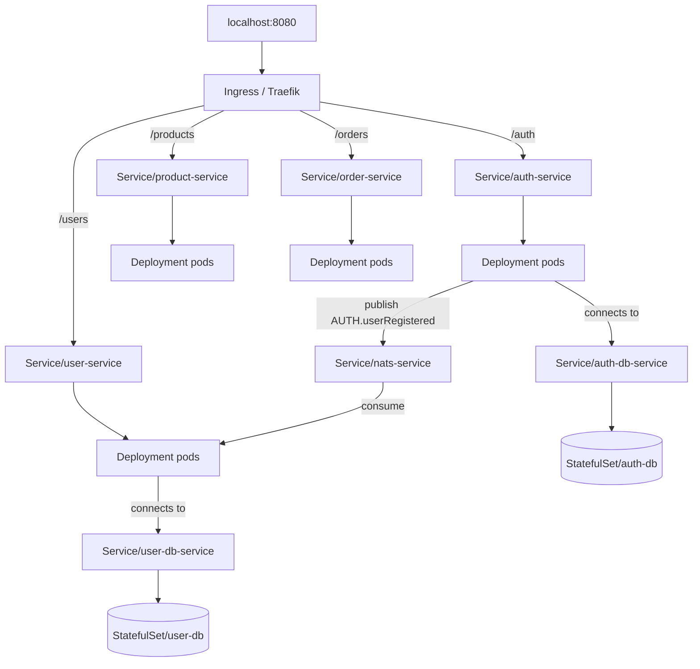

# Kubernetes in this project

How the services are described and wired on the cluster. Manifests live in [`k8s/`](../k8s/).

## What we use Kubernetes for

Kubernetes runs the app workloads, Postgres databases, and NATS as cluster objects: desired replicas, internal DNS names, config/secrets, persistent storage for Postgres, and a single Ingress entrypoint for HTTP.

Locally the API server is provided by **k3d/k3s** (see [k3d and Skaffold](./k3d-and-skaffold.md)). The same manifest shapes are what you would target on a “real” cluster later.

## Layout (`k8s/`)

| Manifest                    | Kind(s)                            | Role                                                             |
| --------------------------- | ---------------------------------- | ---------------------------------------------------------------- |
| `user-service.yaml`         | Deployment, Service                | NestJS user API + NATS consumer; init waits for Postgres         |
| `auth-service.yaml`         | Deployment, Service                | NestJS auth API (`POST /auth/register`); init waits for Postgres |
| `product-service.yaml`      | Deployment, Service                | NestJS product API                                               |
| `order-service.yaml`        | Deployment, Service                | Go order API                                                     |
| `order-service-config.yaml` | ConfigMap                          | Env for order-service (e.g. downstream URLs)                     |
| `user-db.yaml`              | StatefulSet, Service, PVC template | Postgres for user-service                                        |
| `user-db-config.yaml`       | ConfigMap, Secret                  | DB connection settings and credentials                           |
| `auth-db.yaml`              | StatefulSet, Service, PVC template | Postgres for auth-service                                        |
| `auth-db-config.yaml`       | ConfigMap, Secret                  | Auth DB connection settings and credentials                      |
| `nats.yaml`                 | Deployment, Service                | NATS with JetStream (`-js`)                                      |
| `ingress.yaml`              | Ingress                            | Path-based routing via Traefik                                   |

Skaffold applies these (all of them by default, or the app subset with `-p apps`). You can also `kubectl apply -f k8s/` by hand.

## Workloads

- **Deployments** (`user-service`, `auth-service`, `product-service`, `order-service`, `nats`) — stateless app / messaging pods. App images are local tags (e.g. `auth-service:…`) with `imagePullPolicy: Never` / `IfNotPresent` so the node uses images imported from the host instead of pulling from a registry.
- **StatefulSets** (`user-db`, `auth-db`) — Postgres with a stable network identity and a volume claim for data that should survive pod restarts.

## Networking

- **ClusterIP Services** — Stable DNS names inside the cluster (`user-service`, `auth-service`, `product-service`, `order-service`, `user-db-service`, `auth-db-service`, `nats-service`). Pods talk to each other by Service name, not by pod IP.
- **Ingress** (`ecommerce-ingress`) — Traefik (`ingressClassName: traefik`) routes:
  - `/users` → `user-service:3000`
  - `/auth` → `auth-service:3000`
  - `/products` → `product-service:3000`
  - `/orders` → `order-service:3000`

With the usual k3d port map, that is exposed on the host as `http://localhost:8080/...`.

## Auth → NATS → user profile

Registration is split across two services and JetStream:

1. Client calls `POST /auth/register` on `auth-service`.
2. `auth-service` writes credentials to `auth-db` and publishes `AUTH.userRegistered`.
3. `user-service` consumes that subject (durable consumer on the `AUTH` stream) and upserts a profile in `user-db`.

Both app Deployments get `NATS_URL=nats://nats-service:4222`. Order checkout still verifies via `user-service` (`USER_SERVICE_URL`), not auth directly.

## Config and secrets

- **ConfigMaps** — non-sensitive settings (DB host/port/name, order-service URLs).
- **Secrets** (`user-db-secret`, `auth-db-secret`) — DB passwords and `DATABASE_URL` (fine for a local sandbox; do not treat as production secret management).

Apps load these with `envFrom` / `configMapRef` / `secretRef` in their pod specs.

## Storage

Postgres uses a **PersistentVolumeClaim** (via the StatefulSet volume claim template) and the cluster’s **local-path** StorageClass (Rancher local-path provisioner, bundled with k3s/k3d). Claim template names can be shared across StatefulSets; PVC names stay unique as `<claim>-<statefulset>-<ordinal>`. If the node runs out of disk, pods can stick in `Pending` with a disk-pressure taint — see [Disk pressure](../README.md#disk-pressure-k3d--docker) in the root README.

## Mental model



Inspect with:

```bash
kubectl get pods,svc,ingress,pvc
kubectl describe ingress ecommerce-ingress
```
