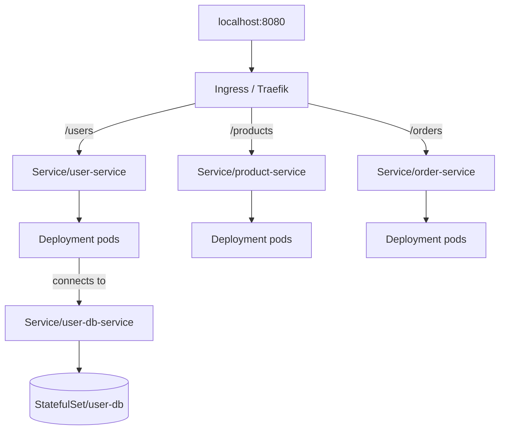

# Kubernetes in this project

How the services are described and wired on the cluster. Manifests live in [`k8s/`](../k8s/).

## What we use Kubernetes for

Kubernetes runs the three app workloads and the user-service database as cluster objects: desired replicas, internal DNS names, config/secrets, persistent storage for Postgres, and a single Ingress entrypoint for HTTP.

Locally the API server is provided by **k3d/k3s** (see [k3d and Skaffold](./k3d-and-skaffold.md)). The same manifest shapes are what you would target on a “real” cluster later.

## Layout (`k8s/`)

| Manifest | Kind(s) | Role |
| -------- | ------- | ---- |
| `user-service.yaml` | Deployment, Service | NestJS user API; init container waits for Postgres |
| `product-service.yaml` | Deployment, Service | NestJS product API |
| `order-service.yaml` | Deployment, Service | Go order API |
| `order-service-config.yaml` | ConfigMap | Env for order-service (e.g. downstream URLs) |
| `user-db.yaml` | StatefulSet, Service, PVC template | Postgres for user-service |
| `user-db-config.yaml` | ConfigMap, Secret | DB connection settings and credentials |
| `ingress.yaml` | Ingress | Path-based routing via Traefik |

Skaffold applies these (all of them by default, or the app subset with `-p apps`). You can also `kubectl apply -f k8s/` by hand.

## Workloads

- **Deployments** (`user-service`, `product-service`, `order-service`) — stateless app pods. Images are local tags (e.g. `user-service:…`) with `imagePullPolicy: Never` / `IfNotPresent` so the node uses images imported from the host instead of pulling from a registry.
- **StatefulSet** (`user-db`) — Postgres with a stable network identity and a volume claim for data that should survive pod restarts.

## Networking

- **ClusterIP Services** — Stable DNS names inside the cluster (`user-service`, `product-service`, `order-service`, `user-db-service`). Pods talk to each other by Service name, not by pod IP.
- **Ingress** (`ecommerce-ingress`) — Traefik (`ingressClassName: traefik`) routes:
  - `/users` → `user-service:3000`
  - `/products` → `product-service:3000`
  - `/orders` → `order-service:8080`

With the usual k3d port map, that is exposed on the host as `http://localhost:8080/...`.

## Config and secrets

- **ConfigMaps** — non-sensitive settings (DB host/port/name, order-service URLs).
- **Secret** (`user-db-secret`) — DB password (fine for a local sandbox; do not treat as production secret management).

Apps load these with `envFrom` / `configMapRef` / `secretRef` in their pod specs.

## Storage

Postgres uses a **PersistentVolumeClaim** (via the StatefulSet volume claim template) and the cluster’s **local-path** StorageClass (Rancher local-path provisioner, bundled with k3s/k3d). If the node runs out of disk, pods can stick in `Pending` with a disk-pressure taint — see [Disk pressure](../README.md#disk-pressure-k3d--docker) in the root README.

## Mental model



Inspect with:

```bash
kubectl get pods,svc,ingress,pvc
kubectl describe ingress ecommerce-ingress
```
